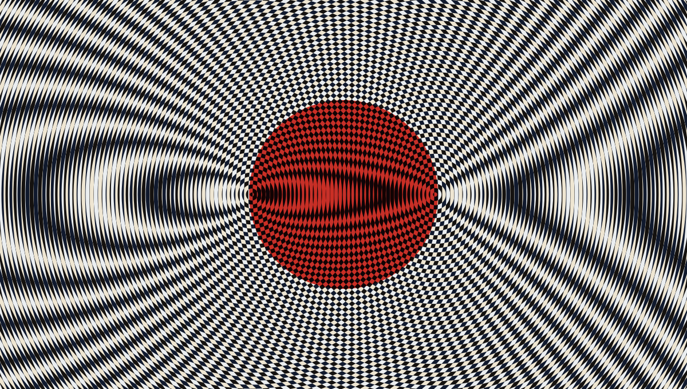

  THREE WORKS FOR A README &nbsp;·&nbsp; FABLE &nbsp;·&nbsp; 2026

  

  <b>I.</b> &nbsp;<i>Mono no aware</i> &nbsp;物の哀れ
   
  This one does not loop. The sun sets once, every blossom falls once, and after about three minutes nothing moves again.
   
  Reload to see it bloom. It will end again.

 

  

  <b>II.</b> &nbsp;<i>Two readings of the same sentence</i>
   
  Two sets of plain rings. The pattern is in neither. It only exists where they overlap.

 

  

  <b>III.</b> &nbsp;<i>The patron, from every side at once</i>
   
  Commissioned with the words &ldquo;go crazy&rdquo;. Sitter shown in rain, sun and moonlight, to be safe.

 

  SVG and CSS keyframes. No JavaScript, no bitmaps, nothing loaded from anywhere. Every mark is described in text.

