  

  <code>warning: the behavior of this profile is undefined.</code>
   
  offensive security · content engineer · UK · <a href="https://www.undefinedbehaviors.com/">UB// undefinedbehaviors.com</a>

  

<pre>
kd&gt; !analyze -v
*******************************************************************************
*                            Bugcheck Analysis                                *
*******************************************************************************

MEA_CULPA (c0000005)
The process did exactly what it was told to do. That was the problem.
Arguments:
Arg1: 0000000000000001, offensive security
Arg2: 0000000000000002, content engineer
Arg3: 0000000000000044, UK
Arg4: ffffb001c0de0000, <a href="https://www.undefinedbehaviors.com/">undefinedbehaviors.com</a>

PROCESS_NAME:       Rabbitbong.exe
IMAGE_NAME:         undefinedbehaviors.sys
FAILURE_BUCKET_ID:  0xUB_WORKED_IN_THE_LAB

kd&gt; k
 # Call Site                                What it does
00 <a href="https://github.com/Rabbitbong/node2shell">node2shell</a>!BrotliDecoder::OobWrite+0x10  Node.js Brotli heap OOB write to RCE, CVE-2026-111497
01 <a href="https://github.com/Rabbitbong/AppBound0">AppBound0</a>!Elevator::DecryptAppBoundKey   Chrome / Edge App-Bound Encryption bypass
02 <a href="https://github.com/Rabbitbong/tokenrun">tokenrun</a>!CreateProcessAsUserW            run a program under a token copied from another process
03 <a href="https://github.com/Rabbitbong/MemoryGlass">MemoryGlass</a>!UnhookNtdll                  memory dumps through an unhooked ntdll
04 <a href="https://github.com/Rabbitbong/OurSharePoint-CVE-2025-53770">OurSharePoint</a>!TypeConfuseDelegate        SharePoint RCE chain in one binary, CVE-2025-53770
05 <a href="https://github.com/Rabbitbong/trust-me-bro-jar">trust_me_bro_jar</a>!SwapPublicKey           Elasticsearch licenses signed with your own key
06 <a href="https://www.undefinedbehaviors.com/">undefinedbehaviors</a>!WriteItUp             the blog, where the above gets explained
07 ntdll!RtlUserThreadStart
</pre>

  
   
  <code>kd&gt; .dump /ma</code> &nbsp;last known image of the process. the umbrella survived.

  

  

  no rabbits were harmed. the process was.

